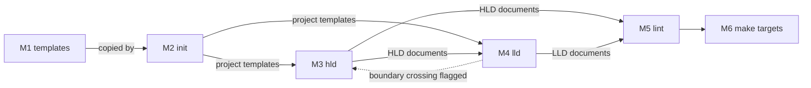

# Architecture: blueprint

## Overview

`blueprint` is a single plugin covering both design levels (D1). It has three command-only skills, a set of templates, a lint script and two make targets.

A project is a directory with `.blueprints/_rules/` in its root. A repository can hold several projects, and a project can nest inside another, where it implements one of the parent's components (D13). In each project:

- The HLD lives in the root as `SYSTEM.md`, `ARCHITECTURE.md`, `ROADMAP.md` and decision records in `docs/adr/`.
- The LLD lives in `.blueprints/<component>/`, one directory per component (D8, D12).

Every document except the plan and the decision records is living: it says what is true now, and git keeps its history (D2). Every document carries a `status:` (D14). IDs use a separate set of prefixes at each level (D3).

How the parts work together:

1. `init` (M2) copies the templates (M1) into a project's `.blueprints/_rules/` and adds a short section to the project's `CLAUDE.md`.
2. The operator then works with `hld` (M3) and `lld` (M4) in any order (D16). Each skill reads its level's documents, the level above and the code, reviews them for gaps and contradictions, interviews the operator, and writes what is agreed by the project's templates.
3. `lld` flags any design that crosses into the HLD, and the operator takes it to `hld` (D4).
4. The lint (M5) parses every document's front matter and citations. `make check` (M6) runs the lint with the plugin's other offline checks.

Technology:

- Claude Code plugin skills, all command-only (D5).
- Markdown documents with flat front matter (SC3).
- Bash and `jq` for scripts, with the Python standard library only where Bash gets unreadable (D7).
- `make` as the entry point for checks and evals.

## Patterns

None.

## Components

### M1 templates

The project's planning rules: one template per document type, shipped in the plugin's own `.blueprints/_rules/` and copied into each project, which owns its copy and may adapt it.

Serves: SC3. Decisions: D6, D12, D17.

Contracts:

- I1. Document templates: a set of files, `.blueprints/_rules/<document>_template.md`, one per document type (`NNNN-ADR_template.md` for decision records). Used by M2, M3 and M4. Defined in this plugin's `.blueprints/_rules/`.

### M2 init

Scaffolds a project. It copies the plugin's templates into the project, never overwriting a file the project has changed without asking, and adds a `blueprint` section between markers in the project's `CLAUDE.md`. It also recognises when the new project is nested inside another.

Serves: SC2, SC3. Decisions: D5, D6, D13.

Contracts:

- I2. Project scaffold: a directory layout, `.blueprints/_rules/` in the project root. Its presence marks a directory as a project root. Used by M3, M4 and M5. Defined in `skills/init/SKILL.md`.

### M3 hld

The expert architect for the HLD. It reviews the system intent, architecture, roadmap and decision records for gaps, contradictions and the usual model failure modes, interviews the operator until each issue is settled, and writes what is agreed by the templates. It stays at the level of components, contracts, data ownership, quality targets and decisions.

It draws on the `pattern-*` skills available in the session, from the separate `patterns` plugin or the project, as a source of options and a lens in review, and records each adopted pattern in its decision record and the Patterns section of `ARCHITECTURE.md`.

Serves: SC4, SC5, SC6, SC8. Decisions: D5, D11, D14, D15, D16, D17.

Contracts:

- I3. HLD documents: files, `SYSTEM.md`, `ARCHITECTURE.md`, `ROADMAP.md` and `docs/adr/NNNN-<slug>.md`, defining the IDs `SC`, `SQT`, `M`, `I` and `D`. Used by M4 and M5. Defined by the templates in I1.

### M4 lld

The expert architect and analyst for one component's LLD, grounded in the code as it is. It reviews the component's intent, spec, proofs and plan against each other, the HLD and the code, interviews the operator until each issue is settled, and writes what is agreed by the templates. It flags boundary crossings instead of writing them, and applies the project's `policy-*` skills.

Serves: SC4, SC5, SC6, SC7, SC8. Decisions: D4, D5, D8, D9, D16.

Contracts:

- I4. LLD documents: files, `.blueprints/<component>/INTENT.md`, `SPEC.md`, `PROOFS.md` and `PLAN.md`, defining the IDs `C`, `QT` and `R`. Used by M5. Defined by the templates in I1.

### M5 lint

`lint-docs.sh`. A deterministic check of every planning document in every project in the repository. It checks front matter, including a status that fits the document type, and headings. It also checks that every citation resolves within its project, or for a nested project's `implements:`, in the parent's architecture, and that it does not point to a withdrawn item or a superseded decision. It checks that the patterns in accepted decision records' `patterns:` front matter and the Patterns section of `ARCHITECTURE.md` agree.

Serves: SC3, SC7, SQT1, SQT2. Decisions: D3, D7, D10, D13, D14, D17.

Contracts:

- I5. Lint command: a command line taking the directory to check, exiting non-zero with one line per error. Used by M6. Defined in `lint-docs.sh`.

### M6 make targets

The entry points for checking the plugin. `make check` runs plugin validation, shellcheck, the lint and the lint's own tests, and makes no model calls. `make evals` runs the billed evals of the skills and is never run by `make check`.

Serves: SQT1, SQT2, SQT3. Decisions: D7.

Contracts:

- I6. `make check` and `make evals`: commands run by the operator and CI. No component uses them. Defined in the plugin's `Makefile`.

## Data ownership

| Data | Owner | Readers |
| --- | --- | --- |
| Plugin templates, in the plugin's `.blueprints/_rules/` | M1 | M2 |
| Project templates, in the project's `.blueprints/_rules/` | M2 | M3, M4, M5 |
| The `blueprint` section of a project's `CLAUDE.md` | M2 | none |
| HLD documents | M3 | M4, M5 |
| LLD documents | M4 | M5 |

## Open questions

- Does `init` write a separate opt-in marker, or is `.blueprints/_rules/` enough to mark a project root, as I2 assumes? If a separate marker is needed, what reads it?
- The operator edits project templates by hand, yet M2 is listed as their only writer. Should the data ownership table say so?
- Which headings does the lint require for each document: those in the project's templates, or a fixed set in the lint?
- What runs `make evals`, and where do its eval cases live?
- No decision record covers choosing `make` as the entry point. Does that choice need one?
